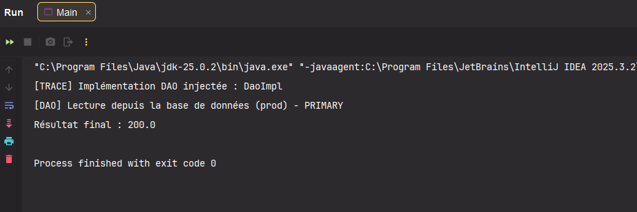
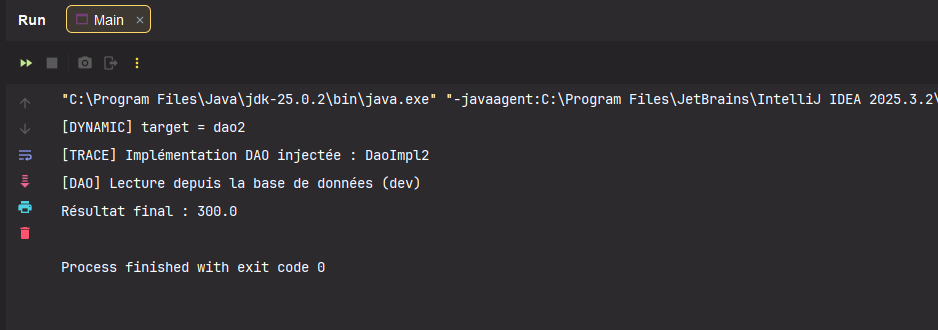
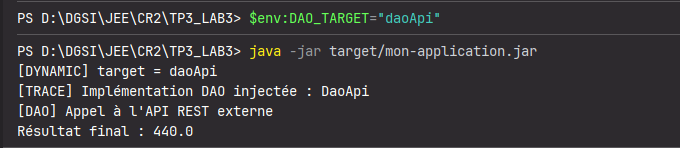

# TP3 / LAB 3 : Injection de Dépendances avec Spring Framework et Respect du Principe OCP (Open/Closed Principle)

---

## 1. Introduction et Prérequis

### Objectifs d'apprentissage
Ce laboratoire a pour but de maîtriser les mécanismes d'injection de dépendances de Spring pour respecter le **Principe d'Ouvert/Fermé (OCP - Open/Closed Principle)**. Vous apprendrez à sélectionner dynamiquement des implémentations de DAO sans toucher au code métier.

### Prérequis techniques
- **JDK 11 ou supérieur** (testé avec JDK 21 / 25)
- **Maven 3.6+**
- **IDE** (IntelliJ IDEA, Eclipse ou VS Code / Antigravity)
- **Connaissances de base** en Java et en Spring Framework (IoC, Annotations `@Component`, `@Autowired`, `@Primary`, `@Configuration`, `@Bean`, `@Value`)

### Ce que vous allez apprendre
Vous découvrirez comment utiliser `@Primary`, les beans de configuration (`@Configuration`, `@Bean`), et les propriétés externes (fichiers `.properties` et variables d'environnement) pour basculer facilement entre différentes sources de données (Base de données locale, Base de dev, Fichier, API REST externe) tout en gardant la classe `MetierImpl` rigoureusement inchangée.

---

## 2. Le problème OCP (Open/Closed Principle)

### Le problème initial
Imaginez une application où la classe `MetierImpl` dépend directement d'une implémentation concrète `DaoImpl` :
```java
// Violation de l'OCP : couplage fort avec l'implémentation concrète
public class MetierImpl {
    private DaoImpl dao = new DaoImpl();
}
```
Si vous voulez changer la source de données (par exemple, passer d'une base de données à un fichier ou à une API REST), vous devez **modifier le code source de `MetierImpl`**. Cela viole directement le principe OCP (*les entités logicielles doivent être ouvertes à l'extension, mais fermées à la modification*).

### La solution Spring
Spring résout ce problème via l'**Inversion de Contrôle (IoC)** et l'**Injection de Dépendances (DI)** :
1. La classe métier `MetierImpl` dépend exclusivement d'une interface d'abstraction : `IDao`.
2. Le conteneur IoC Spring instancie les composants et décide quelle implémentation concrète injecter.
3. Le couplage est totalement lâche (*loose coupling*).

> **Note importante :** L'objectif absolu est de **ne JAMAIS modifier `MetierImpl`** pour changer de source de données. Toute la logique de sélection est externalisée dans la configuration.

---

## 3. Architecture du Projet

```text
TP3_LAB3/
├── pom.xml                                      # Configuration Maven et dépendances
├── screenshots/                                 # Captures d'écran des exécutions
│   ├── 01-execution-dao-primary.png
│   ├── 02-execution-dao-check.png
│   ├── 03-execution-dynamic-properties.png
│   └── 04-execution-env-variable-jar.png
└── src/
    ├── main/
    │   ├── java/
    │   │   ├── Main.java                        # Point d'entrée de l'application
    │   │   ├── config/
    │   │   │   ├── AppConfig.java               # Configuration principale Spring (@ComponentScan, @PropertySource, @Import)
    │   │   │   ├── DaoAliasConfig.java          # Configuration par @Bean / Alias
    │   │   │   └── DynamicDaoConfig.java        # Sélection dynamique du DAO (Env Var -> Properties -> Défaut)
    │   │   ├── dao/
    │   │   │   ├── IDao.java                    # Interface du DAO (contrat d'accès aux données)
    │   │   │   ├── DaoImpl.java                 # Implémentation Base de données Prod (valeur = 100.0)
    │   │   │   ├── DaoImpl2.java                # Implémentation Base de données Dev (valeur = 150.0)
    │   │   │   ├── DaoFile.java                 # Implémentation Fichier local (valeur = 180.0)
    │   │   │   ├── DaoApi.java                  # Implémentation API REST externe (valeur = 220.0)
    │   │   │   └── DaoImplProd.java             # Implémentation avec profil @Profile("prod")
    │   │   └── metier/
    │   │       ├── IMetier.java                 # Interface métier (double calcul())
    │   │       ├── MetierImpl.java              # Implémentation métier principale (injecte IDao)
    │   │       └── MetierMultiple.java          # Implémentation avec injection multiple (List / Map de DAOs)
    │   └── resources/
    │       └── app.properties                   # Fichier de propriétés externe (dao.target=...)
    └── test/
        └── java/test/
            └── OcpSelectionTest.java            # Test unitaire de validation OCP
```

---

## 4. Étapes de Réalisation & Mécanismes d'Injection

### Étape 1 : Injection avec `@Primary`
Lorsqu'il existe plusieurs implémentations de `IDao` (`DaoImpl`, `DaoImpl2`, `DaoFile`, `DaoApi`), Spring lève une ambiguïté (`NoUniqueBeanDefinitionException`). 
L'annotation `@Primary` indique à Spring l'implémentation par défaut à injecter en l'absence de qualificatif spécifique.

- **Classe Métier (`MetierImpl`) :**
  ```java
  @Service
  @Primary
  public class MetierImpl implements IMetier {
      private final IDao dao;

      public MetierImpl(IDao dao) {
          this.dao = dao;
      }

      @PostConstruct
      public void init() {
          System.out.println("[TRACE] Implémentation DAO injectée : " + dao.getClass().getSimpleName());
      }

      @Override
      public double calcul() {
          return dao.getValue() * 2.0;
      }
  }
  ```

#### Résultat de l'exécution (Étape 1) :

*(Image disponible également dans `src/Screenshot 2026-10-20 143615.png`)*

---

### Étape 2 : Configuration Dynamique via `app.properties`

Pour basculer d'une source à une autre sans recompiler l'application, on externalise le choix dans `src/main/resources/app.properties` :
```properties
dao.target=dao2
```

La classe `DynamicDaoConfig` crée le bean `@Primary` correspondant à la cible demandée :
```java
@Configuration
public class DynamicDaoConfig {

    @Value("${DAO_TARGET:${dao.target:dao}}")
    private String daoTarget;

    @Bean
    @Primary
    public IDao dynamicDao() {
        System.out.println("[DYNAMIC] target = " + daoTarget);
        switch (daoTarget) {
            case "dao":
                return new DaoImpl();
            case "dao2":
                return new DaoImpl2();
            case "daoFile":
                return new DaoFile();
            case "daoApi":
                return new DaoApi();
            default:
                throw new IllegalArgumentException("Cible DAO inconnue: " + daoTarget);
        }
    }
}
```

#### Résultat de l'exécution avec `dao.target=dao2` :

*(Image disponible également dans `src/Screenshot 2026-10-20 150719.png`)*

---

### Étape 3 : Déploiement et Configuration en Production (Variables d'Environnement & JAR Autonome)

En production (containers Docker, Kubernetes, CI/CD, serveurs cloud), il est recommandé de passer les propriétés via des **variables d'environnement** plutôt que de modifier des fichiers de configuration internes.

#### Hiérarchie de configuration Spring
Spring charge les propriétés dans l'ordre de priorité suivant :
1. **Variables d'environnement système** (`DAO_TARGET`)
2. **Fichier de propriétés externe** (`app.properties` ou `application.properties`)
3. **Valeurs par défaut dans le code** (`dao`)

L'expression SpEL suivante implémente rigoureusement cette hiérarchie :
```java
@Value("${DAO_TARGET:${dao.target:dao}}")
private String daoTarget;
```

#### Packaging du JAR exécutable (`pom.xml`)
Le plugin `maven-shade-plugin` assemble toutes les dépendances Spring dans un seul JAR exécutable autonome :
```xml
<build>
    <finalName>mon-application</finalName>
    <plugins>
        <plugin>
            <groupId>org.apache.maven.plugins</groupId>
            <artifactId>maven-shade-plugin</artifactId>
            <version>3.5.1</version>
            <executions>
                <execution>
                    <phase>package</phase>
                    <goals><goal>shade</goal></goals>
                    <configuration>
                        <transformers>
                            <transformer implementation="org.apache.maven.plugins.shade.resource.ManifestResourceTransformer">
                                <mainClass>Main</mainClass>
                            </transformer>
                        </transformers>
                    </configuration>
                </execution>
            </executions>
        </plugin>
    </plugins>
</build>
```
#### Résultat de l'exécution en Production :

*(Image disponible également dans `src/Screenshot 2026-10-20 150913.png`)*

---

## 7. Résumé et Conclusion

### Ce que nous avons appris
- **Le principe OCP :** Permet d'étendre et de modifier le comportement fonctionnel de l'application sans modifier une seule ligne de code existant (`MetierImpl`).
- **Spring IoC :** Résout élégamment l'ambiguïté d'injection grâce aux mécanismes `@Primary`, aux alias de configuration `@Bean`, et à l'injection dynamique par fabrique.
- **La configuration externe :** Représente la meilleure pratique pour assurer la portabilité et la flexibilité entre les environnements de développement, de test et de production.
- **Les tests de non-régression :** Garantissent que les contrats d'interface et le comportement métier demeurent stables à chaque changement de configuration.
